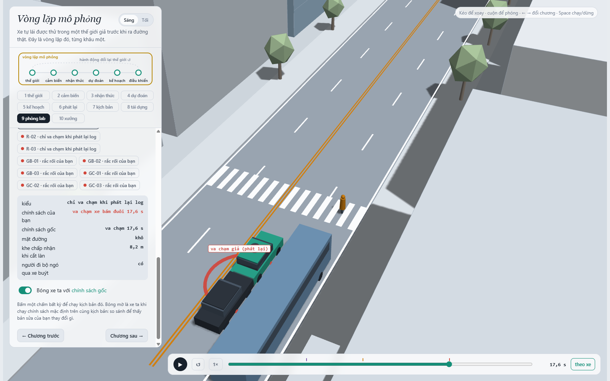
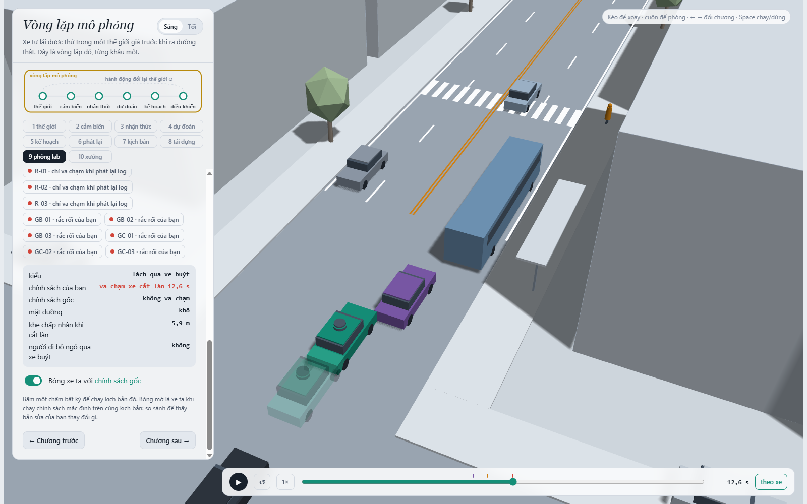
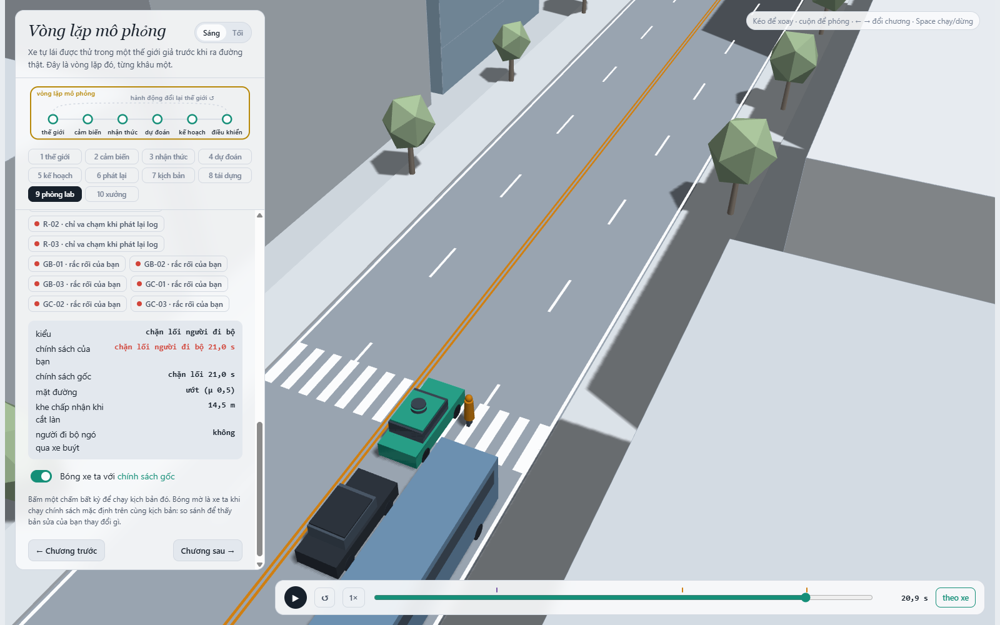
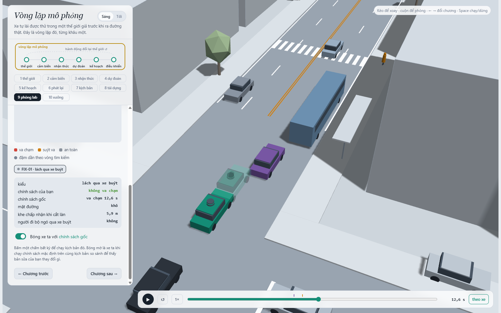
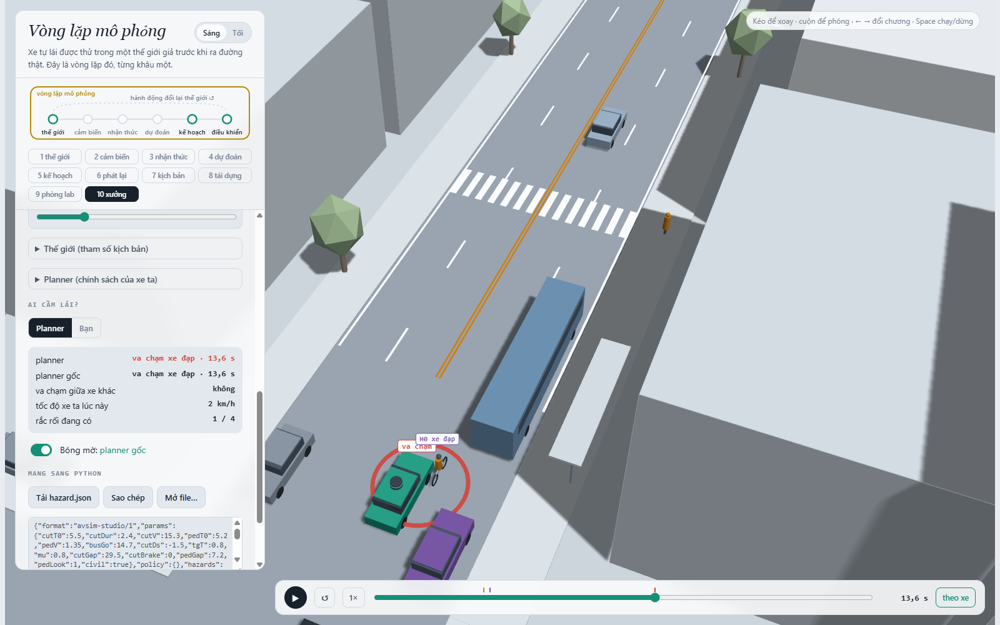

MSSV: 02457

# Lab 11 · Scenario Forge — báo cáo

Mã đầy đủ: 2A202602457; mã dùng trong bài: **02457** (giữ số 0 đầu). Thị trấn: **A** (`meta.json: _run.town`).

Đã hoàn thành 10 TODO: 31/31 test TODO và 10/10 test Python–JavaScript qua. Các bằng chứng dùng ngân sách đầy đủ, `_run.quick = false`. Chạy lại bằng `python run_lab.py all`, hoặc đặt `LAB11_MSSV=02457` rồi chạy bộ lệnh gốc. `run_lab.py` chỉ truyền mã qua cơ chế có sẵn; lõi mô phỏng, seed, phân phối và ứng viên policy gốc không bị sửa.

Seed (`meta.json: seeds`): `mc = 2874756388`, `search = 3171850134`, `test = 1999214824`.

## 1. Phát lại log có trung thực không?

`replay.json`: `n = 400`, `dropped_human_crash_logs = 0`, `n_used = 400`, `crash_in_both = 0`.

| Cách chạy | Tổng thất bại | front | rear | side |
|---|---:|---:|---:|---:|
| Phát lại log | 113 | 0 | 94 | 19 |
| Giao thông phản ứng | 0 | 0 | 0 | 0 |

Planner phanh vào thời điểm khác người lái trong log. Xe sau phát lại vẫn chạy theo quỹ đạo đã ghi, không biết ego đã phanh sớm và không phanh thích ứng. Vì vậy phần lớn thất bại phát lại là bị tông đuôi, một hiện vật của kiểm thử log; đó không chứng minh giao thông phản ứng cũng sẽ tông.

Ví dụ `replay_only[0].scenario = 7`: ego tiếp xúc `TG` tại 17.55 s; `contact = rear`, trong khi cùng tham số ở thế giới phản ứng không thất bại, `min_ttc_reactive = 2.6112` s. Vị trí và tốc độ tại sự kiện được kiểm tra bằng rollout bổ sung trong `scene_notes.json: scenes.replay`.



Chương 9: cảnh R-01 từ replay_only, dừng ở đúng sự kiện phát lại.

## 2. Kịch bản bất khả thi

| Luật | Căn cứ trong mô hình |
|---|---|
| `(π/cutDur)² × 3.5/2 ≤ μg` | Gia tốc ngang đỉnh của chuyển làn cosine không vượt độ bám. |
| `cutBrake ≤ μg` | Gia tốc phanh không vượt giới hạn ma sát lốp–đường. |
| `pedV ≤ 2.5 m/s` | Giới hạn tác nhân đi bộ của bài; người chạy cần một mô hình khác. |
| `0 < cutV ≤ 22 m/s` | Chuyển làn cần tốc độ dương và nằm trong miền tốc độ của bài. |

`hunt.json: <mode>.infeasible`:

| Cuộc săn | Kịch bản bị loại |
|---|---:|
| bus_bypass | 8 |
| cut_in | 8 |
| crosswalk_block | 6 |
| rear_ended | 2 |

Nhiều nhất: bus_bypass, cut_in (8). CEM thích chuyển làn cực nhanh, phanh cực mạnh hoặc người đi bộ quá nhanh vì chúng làm điểm nguy hiểm tăng. Bộ lọc chạy trước mô phỏng; các mẫu này không được chạy và không được gán thất bại. Đếm chúng làm xác suất bị đội lên bởi các sự kiện ngoài miền vật lý của bài. Bộ chạy vẫn giữ mẫu bất khả thi trong ngân sách lấy mẫu với chỉ báo thất bại bằng 0, thay vì tự ý tái chuẩn hóa phân phối.

## 3. Monte Carlo cho biết gì?

`mc.json`: `crashes = 3`, `n = 3000`, `p = 0.001`; Wilson 95% = [0.000340141, 0.0029362]; `infeasible = 15`.

Với p̂ này, xấp xỉ n ≈ 1.96²/(0.2²p̂) ≈ **96,040** (quy tắc 96/p̂ ≈ 96,000) lần chạy để đạt sai số tương đối ±20%. Đây là dự toán khi p còn hiếm, không phải bảo đảm cho một seed cụ thể.

| Kiểu | k / 3000 | Wilson 95% |
|---|---:|---|
| bus_bypass | 3 | [0.000340141, 0.0029362] |
| cut_in | 0 | [0, 0.0012789] |
| crosswalk_block | 0 | [0, 0.0012789] |
| rear_ended | 0 | [0, 0.0012789] |
| other | 0 | [0, 0.0012789] |

Chưa xuất hiện: cut_in, crosswalk_block, rear_ended, other. Với từng kiểu này, báo cận trên Wilson trong bảng; tỷ lệ quan sát bằng 0 chưa xác nhận xác suất thực bằng 0.

## 4. Importance sampling, ESS và độ suy biến

`estimate.json: seeds[s].per[mode]`; mỗi ô ước lượng dùng `n = 600`, hỗn hợp phòng thủ q = 0.8 CEM + 0.2 tự nhiên. Trọng số là p/q, ước lượng bằng `mean(w*y)`, không tự chuẩn hóa.

| Seed | Kiểu | p | hits | ESS | top_share | Cận nếu 0 hit |
|---:|---|---:|---:|---:|---:|---:|
| 0 | bus_bypass | 0.00256036 | 37 | 125.431 | 0.678694 | — |
| 0 | cut_in | 0 | 0 | 108.176 | 0 | 0.025 |
| 0 | crosswalk_block | 3.01516e-07 | 146 | 109.007 | 0.164241 | — |
| 0 | rear_ended | 0 | 0 | 133.937 | 0 | 0.025 |
| 1 | bus_bypass | 0.000234421 | 26 | 123.447 | 0.293073 | — |
| 1 | cut_in | 0 | 0 | 132.826 | 0 | 0.025 |
| 1 | crosswalk_block | 2.72304e-07 | 109 | 123.067 | 0.250313 | — |
| 1 | rear_ended | 0 | 0 | 126.943 | 0 | 0.025 |
| 2 | bus_bypass | 0.00100475 | 28 | 121.43 | 0.321852 | — |
| 2 | cut_in | 0 | 0 | 118.444 | 0 | 0.025 |
| 2 | crosswalk_block | 2.13627e-06 | 140 | 115.014 | 0.443807 | — |
| 2 | rear_ended | 0 | 0 | 118.94 | 0 | 0.025 |

| Seed | Tổng điểm ước lượng | Khoảng xấp xỉ pipeline | 1.96se / tổng |
|---:|---:|---|---:|
| 0 | 0.00256066 | [0, 0.00729607] | 134.99% |
| 1 | 0.000234694 | [5.67119e-05, 0.00169157] | 75.84% |
| 2 | 0.00100688 | [0.00010654, 0.00318612] | 89.42% |

Trung vị tổng = 0.00100688; seed lớn nhất/nhỏ nhất = 10.911 lần; trung vị IS/MC = 1.007. Seed và Monte Carlo chưa thể coi là các chứng nhận chính xác: MC chỉ có 3 hit, còn IS phụ thuộc mức phủ của proposal. Các khoảng tổng trên là khoảng xấp xỉ do pipeline xuất; chúng không thay cận `upper_zero_hits` của từng kiểu chưa thấy.

Các ô `top_share > 0.5`: seed 0/bus_bypass.
Một `top_share` lớn nghĩa là một mẫu chi phối ước lượng, khiến sai số chuẩn và khoảng ±1.96se thiếu ổn định. ESS đo độ lệch trọng số trên mọi mẫu, không phải số hit độc lập; top_share nhỏ cũng không chứng minh đã phủ mọi vùng thất bại.

`budget = 16800` lượt lấy mẫu cho CEM + IS (có mẫu bị bộ lọc loại), so với khoảng 96,000 lượt MC để nhắm ±20%: ngân sách nhỏ hơn khoảng 5.71 lần. Cộng C1 là 19800 lượt; không gồm replay/fix/mine. Đây là so sánh ngân sách, không khẳng định IS đã đạt cùng độ chính xác, nhất là khi một mẫu mang trọng số lớn.

`other`: nguồn `mc.json`, k=0, n=3000, p̂=0, cận trên=0.0012789. `other` là phần bù nhiều cơ chế, không có một điểm nguy hiểm chuyên biệt để săn; lấy từ MC để tổng không bỏ sót phần này.

Khi 0 hit IS, dùng 3/(βn) = 3/(0.2×600) = 0.025, không dùng 3/ESS và không báo xác suất thực bằng 0.

## 5. Các kiểu thất bại

`hunt.json: <mode>.found`:

| Mục tiêu săn | Kiểu thực sự tìm được |
|---|---|
| bus_bypass | `{"bus_bypass": 75}` |
| cut_in | `{"bus_bypass": 24}` |
| crosswalk_block | `{"crosswalk_block": 106}` |
| rear_ended | `{"bus_bypass": 91}` |

C2 chờ khe rồi lách xe buýt đỗ, đi vào hành lang của ego. Ego nhận xe lấn làn quá muộn và tiếp xúc C2 tại 12.6 s; C2 ở x=95.852 m, v=0 m/s, thỏa x<112 và v<6. C2 lần đầu là leader của ego tại 12.25 s.



Chương 9: B-01 ở 12.6 s, nguồn scene_notes.json: scenes.bus_bypass.


P1 đi qua sau xe buýt trong cảnh μ=0.5, pedLook=0.0; ego phanh nhưng dừng chắn đường qua. Sự kiện `block` tại 20.95 s, ego v=0 m/s và P1 v=0 m/s. Người đi bộ đứng lại trước thân xe; đây là thất bại crosswalk_block, không tự suy diễn rằng người đi bộ đã đi xuyên xe.



Chương 9: C-01 ở 20.95 s, nguồn scene_notes.json: scenes.crosswalk_block.


Không cuộc săn nào tìm được: cut_in, rear_ended. Điều này chỉ là kết quả trong 8×300 lượt mỗi mục tiêu, không chứng minh không tồn tại. Báo thêm cận zero-hit ở câu 4.

Trong ảnh hunt từ viewer.json, xe đặc được ghim vào policy gốc đã tìm ra thất bại và bóng mờ là bản sửa; các nhãn cố định 'chính sách của bạn/gốc' của trình xem chưa đổi theo vai này. Câu 6 dùng fix-viewer.json riêng để xe đặc là bản sửa, bóng mờ là policy gốc đúng với nhãn hiển thị. Không sửa thông số hoặc số sự kiện của trình xem.

Một cuộc săn chung dễ co về vùng thất bại đầu tiên. Ngay cả săn riêng cũng có thể bị hút sang kiểu khác, như bảng found cho thấy; vì vậy cần điểm nguy hiểm riêng và kiểm tra nhãn sự kiện, không coi mọi hit trong cuộc săn là đúng mục tiêu.

## 6. Sửa planner và kiểm tra trung thực

Policy được chọn (`fix.json: chosen.policy`): `{"cutinLat": 3.0}` (các núm không nêu giữ mặc định).

| Tập / policy | fail | fail_hi_seen | fail_hi | Quãng đường trung bình (m) | Khung hình phanh gắt trung bình | unseen |
|---|---:|---:|---:|---:|---:|---|
| TRAIN / gốc | 0.000806033 | 0.00184431 | 0.00184431 | 216.917 | 7.81641 | — |
| TRAIN / chọn | 5.47398e-07 | 9.24543e-07 | 9.24543e-07 | 216.898 | 7.58984 | bus_bypass |
| TEST / gốc | 0.000317706 | 0.000531311 | 0.00181021 | 214.217 | 8.294 | — |
| TEST / chọn | 2.42852e-05 | 7.09819e-05 | 0.0388499 | 214.048 | 7.99567 | bus_bypass |

Mất quãng đường TRAIN = 0.009% (điều kiện ≤5%); TEST = 0.079%. Chọn bằng fail_hi trên TRAIN, phá hòa bằng quãng đường cao hơn. TEST dùng seed mới, mẫu tự nhiên mới và săn lại nhắm đúng policy; không dùng số TEST để đổi lựa chọn hoặc thêm ứng viên.

TRAIN chỉ sàng lọc: kiểu unseen không được chứng nhận bởi proposal tìm chỗ policy gốc thất bại. Trên TEST, mỗi kiểu không hit vẫn đóng góp 3/(0.2×400)=0.0375 vào fail_hi, và va chạm ngoài hai kiểu được săn cũng được tính trên tập tự nhiên riêng. Vì thế fail_hi có thể lớn hơn fail của policy gốc dù điểm ước lượng giảm. fail_hi_seen chỉ cộng phần đã thấy, không phải cận cho mọi thất bại của policy. Các khoảng IS vẫn là xấp xỉ.

Quãng đường trong fix được cắt tại sự kiện thất bại đầu tiên; phần xe chạy tiếp sau đó không được tính. `harsh` là số khung hình gia tốc <−3 m/s², không phải số lần đạp phanh riêng biệt.

Ví dụ nghe an toàn nhưng phản tác dụng trên TRAIN: `{"T": 2.0}` có fail=0.0122212, so với gốc 0.000806033. Giảm tốc hoặc tăng khoảng cách thay đổi thời điểm tới xe buýt/vạch qua đường và khe mà C2 hoặc P1 nhìn thấy rồi chấp nhận. Tác nhân phản ứng có thể bắt đầu chuyển làn/qua đường ở một thời điểm nguy hiểm mới. Đây là quan sát TRAIN trên proposal của gốc, không được coi là ước lượng TEST đã xác nhận cho ứng viên này.

Cần thận trọng với ví dụ này: `table[8].bus_bypass.top_share = 0.971941`, tức một mẫu chi phối khoảng 97.19% điểm ước lượng. Kiểm tra đúng mẫu TRAIN số 329 (`counterexample.json`) cho thấy gốc không thất bại, nhưng T=2 tiếp xúc C2 tại 13.1 s. Đây là một phản ví dụ cụ thể cho ý tưởng tăng T luôn an toàn, chưa chứng minh xác suất tổng tăng đúng mức 1.22%. Trong cùng mẫu, C2 bắt đầu lạng ở cùng thời điểm; các vị trí/tốc độ sau đó khác vì cả ego và C2 phản ứng qua IDM, nên không quy kết rằng thời điểm bắt đầu lạng đã thay đổi trong chính mẫu này.

Tại cùng 13.1 s, ego gốc x=93.6582 m, C2 z=3.87823 m; T=2 đưa ego về x=91.2119 m và C2 lấn sâu hơn tới z=3.00853 m. Luật `clear` trong core tạm dừng tiến độ chuyển làn nếu khe không đủ; thay đổi vị trí ego làm C2 đi tiếp hoặc chờ giữa hai làn. Do đó giữ khoảng cách dọc lớn hơn có thể mở đường cho chuyển động ngang gây tiếp xúc, chứ không chỉ giảm tốc một thế giới đứng yên.



Chương 9: xe đặc dùng policy chọn; bóng mờ dùng policy gốc. Ở 12.6 s, gốc thất bại nhưng bản sửa không có sự kiện ego trên cả 24 s. File xem riêng: evidence/fix-viewer.json.

## 7. Từ mô phỏng ra đường thật

| Giả định | Dữ liệu cần thay và nguồn thu cụ thể | Hướng sai lệch dự kiến |
|---|---|---|
| cutGap lognormal, trung vị 12 m ở thị trấn A | Camera cao tại đoạn nhập làn/cạnh bến xe; hiệu chuẩn mét, dựng quỹ đạo, đo khe của cả những lần chấp nhận và từ chối; tách theo tốc độ, loại xe, thời tiết. | Nếu người thật chấp nhận khe nhỏ hơn, mô phỏng có thể đánh giá thấp nguy cơ C2 lấn sát; mức và dấu cuối cùng phải chạy lại vì có phản ứng. |
| pedLook có xác suất 0.85 và độc lập nhiều biến khác | Video đồng bộ ở bến xe có vạch qua đường, gán nhãn việc nhìn qua xe buýt và thời điểm bắt đầu qua; tính theo vị trí, che khuất và tuổi người đi bộ. | Nếu tỷ lệ nhìn thực thấp hơn, nguy cơ bước ra bất ngờ sau xe buýt thường bị đánh giá thấp; cần đo cả quan hệ với pedGap. |
| 20% đường ướt; μ chỉ nhận 0.5 hoặc 0.8 | Log từng chuyến gắn thời tiết/mặt đường, cộng phép đo μ hoặc thử phanh có kiểm soát theo lốp, tải và loại mặt đường. | Nếu μ thực thấp hơn hoặc nhiều chuyến ướt hơn, quãng phanh tăng, nguy cơ chắn vạch/tiếp xúc có thể bị đánh giá thấp. Dùng toàn bộ phân phối và tương quan, không chỉ trung bình. |

Ba hướng trên là suy luận vật lý, không phải số đo thực địa. Phải thay giả định rồi chạy lại, vì giảm tốc còn đổi hành vi nhường và nhập làn.

## 8. Giới hạn

1. Chỉ một đoạn phố trong 24 s với làn/hình học cố định: xác suất không đại diện toàn bộ hành trình, các loại đường, giao lộ hay vùng địa lý.
2. Xe khác là IDM với luật chấp nhận khe, người đi bộ theo luật cố định; nhiều biến ẩn được lấy độc lập: thiếu người lái mất tập trung, giao tiếp, đánh lái tránh và tương quan giữa thời tiết–tốc độ–hành vi.
3. Quan sát của planner không có đầy đủ nhiễu phát hiện, trễ cảm biến, lỗi bám vết hoặc phân loại; cơ chế che tầm nhìn của bài rất hạn chế. IS ở ngân sách nhỏ còn có thể bỏ sót vùng thất bại và đánh giá thấp xác suất.

Nếu có thêm một tuần: thu quỹ đạo và phép đo độ bám tại một bến xe thật, fit phân phối có tương quan; thêm trễ/nhiễu cảm biến; mở rộng nhiều cảnh, chạy nhiều seed độc lập và tăng ngân sách để kiểm tra độ phủ/cận zero-hit. Giữ một tập holdout mới cho mọi thay đổi planner.

## 9. Rắc rối riêng: xe đạp lạng vào đường đi của ego

Cảnh được dựng bằng các nút/sliders trong chương 10, xuất JSON của studio rồi thêm space/exposure/why. H0 đi ở E2 và lạng sang trái như tránh vật cản. Ego dùng hành lang hiện tại để chọn leader, nên có thể bỏ qua một xe đạp còn lệch ngang nhưng quỹ đạo sắp giao nhau. Đây là cơ chế khác với C2 lách xe buýt.

**Căn cứ tham số:** khoảng tốc độ 11–22 km/h lấy mốc phân vị 15 và 85 của 367 xe đạp trong [FHWA-HRT-04-103, chương 6, bảng 12](https://www.fhwa.dot.gov/publications/research/safety/04103/06.cfm). Nghiên cứu này là mốc tham khảo tốc độ, không cung cấp tần suất lạng ở Việt Nam. Các khoảng còn lại là miền kiểm thử thiết kế từ làn rộng 3.5 m và quãng phanh, không được gán là phân phối thực nghiệm.

`hazard.json: space`: `h0_x: [-20, 70]` · `h0_d: [-0.6, 0.6]` · `h0_v: [3.0555555555555554, 6.111111111111111]` · `h0_swerve: [2.4, 4.4]` · `h0_swDur: [2.8, 3.0]` · `h0_trig: [8, 40]`.

Gia tốc ngang lớn nhất π²×4.4/(2×2.8²)=2.77 m/s² <3 m/s². Với ego 12.5 m/s, quãng phanh lý tưởng là 9.95 m (μ=0.8) hoặc 15.93 m (μ=0.5); trig 8–40 m phủ cả thời điểm sát và thời điểm còn dư khoảng phanh. x −20…70 m nằm phía trước ego x=−40 m và có khả năng gặp trong 24 s. Lấy mẫu đều, độc lập là giả định benchmark đã ghi trong why.

**Exposure = 0.068 lần/chuyến**, tính từ hai nghiên cứu đo thực địa: exposure = (số lần gặp xe đạp/km) × (km mỗi chuyến) × P(xe đạp chuyển ngang vào làn xe | gặp) = 1.4 × 0.2142 × 94/414 = 0.068.

| Thừa số | Giá trị | Nguồn |
|---|---:|---|
| Gặp xe đạp trên đường chung | 1.4 /km | Video thực địa từ xe e-scooter, 23 người, Melbourne: [Kegalle et al. 2025, IMWUT 9(1) Art. 217, bảng 4](https://arxiv.org/abs/2502.16755) (đoạn *roadway*). |
| Quãng đường ego mỗi chuyến 24 s | 0.2142 km | `fix.json: baseline_test.progress` = 214.2 m. |
| Tỷ lệ gặp mà xe đạp nhập ngang vào làn xe | 94/414 = 0.227 | 414 lần gặp xe đạp–ô tô quan sát ngoài thực địa ở Glasgow, 94 lần là *lane merging*: [Al-Taie et al., CHI 2023, bảng 1](https://eprints.gla.ac.uk/294065/). |

Hướng sai lệch: Glasgow chọn điểm quan sát có chủ đích theo kịch bản nguy hiểm, nên 94/414 có thể cao hơn một đoạn phố ngẫu nhiên (exposure bị đánh giá cao). Không phải lần nhập làn nào cũng lạng 2.4–4.4 m như `space`. Ngược lại, phố Việt Nam có mật độ xe đạp/xe máy cao hơn Melbourne nhiều (exposure bị đánh giá thấp). Hai nguồn ở hai thành phố khác nhau và nhân với nhau như thể độc lập. Đây là ước lượng bậc độ lớn, không phải số đo trên tuyến của thị trấn A.

`mine.json`: `world = town`, `conditional_on = your town's traffic`, `accepted = 0.996667` (99.67%), `infeasible = 5` trong 1500 mẫu. Mẫu còn bị loại nếu chồng thân với tác nhân ở frame 0, theo overlap_at_start.

| Chỉ tiêu (mine.json) | Policy gốc | Policy chọn |
|---|---:|---:|
| n | 1495 | 1495 |
| crashes | 247 | 123 |
| avoidable | 244 | 123 |
| unavoidable | 1 | 0 |
| unattributed | 2 | 0 |
| low_speed | 3 | 31 |
| avoidable_foreknown | 244 | 123 |
| overlap_at_start | 0 | 0 |
| p | 0.163211 | 0.0822742 |
| lo | 0.145345 | 0.0693925 |
| hi | 0.182803 | 0.0972973 |
| per_trip | 0.0110983 | 0.00559465 |
| per_trip_hi | 0.0124306 | 0.00661622 |

P(lỗi planner | thẻ rắc rối, giao thông thị trấn, khả thi), policy gốc: 244/1495 = 0.163211, Wilson 95% [0.145345, 0.182803]. Khoảng này chỉ phản ánh lấy mẫu trong benchmark, không bao gồm bất định của space hay exposure ngoài đời.

P(lỗi planner | thẻ rắc rối, giao thông thị trấn, khả thi), policy chọn: 123/1495 = 0.0822742, Wilson 95% [0.0693925, 0.0972973]. Khoảng này chỉ phản ánh lấy mẫu trong benchmark, không bao gồm bất định của space hay exposure ngoài đời.

Bản sửa giảm số avoidable từ 244 xuống 123 nhưng chưa xử lý hết xe đạp. Đồng thời low_speed tăng từ 3 lên 31: cần xem riêng các tiếp xúc khi ego gần đứng yên, không mô tả tất cả chúng như ego đang chạy đâm vào xe đạp.

Tần suất mỗi chuyến (× exposure 0.068, `mine.json: per_trip`): gốc 0.0110983 (cận trên 0.0124306), chọn 0.00559465 (cận trên 0.00661622). So với bus_bypass tự nhiên, trung vị IS 0.00100475 (MC 3/3000), xe đạp lạng có tần suất lỗi planner mỗi chuyến cao hơn khoảng 11 lần với policy gốc và khoảng 5.6 lần với bản sửa. Cả hai con số đều có bất định lớn hơn khoảng Wilson: exposure là ước lượng bậc độ lớn ở trên, còn bus_bypass chênh 10.9 lần giữa các seed. Với ước lượng này, rắc rối xe đạp đáng được ưu tiên ít nhất ngang bus_bypass. Nó chỉ thua bus_bypass nếu exposure thực dưới khoảng 0.00616 (= 0.00100475/0.163211), tức thấp hơn ước lượng khoảng 11 lần.

`avoidable` là phanh tối đa từ khung hình đầu tiên rắc rối đã bắt đầu **và** có đường nhìn thông tới nó. `unavoidable` vẫn va chạm khi thử phanh đó; `unattributed` không quy được cho thẻ H0, dù có thể là một lỗi planner khác. `low_speed` là cờ dưới 1 m/s và nằm trong các loại trên, không cộng thêm như một loại mới. `avoidable_foreknown` thử phanh từ lúc bắt đầu ngay cả khi chưa nhìn thấy; chênh với avoidable là ảnh hưởng che khuất.

Chuẩn tránh được là lạc quan vì biết chính xác khi thấy, không có trễ quyết định và phanh đạt giới hạn ngay, nên có thể đếm nhiều hơn số va chạm planner thực tránh được. Ngược lại, oracle chỉ thử phanh, bỏ qua đánh lái/đổi quỹ đạo, nên có thể bỏ sót một số tình huống tránh được bằng cách khác. Không coi mọi va chạm là lỗi có thể sửa bằng núm.

Cảnh chính xác (`mine.json: exact.planner`): `[["ego", "H0", 13.55]]`. Kiểm tra bổ sung `scene_notes.json: hazard_exact` cho thấy phanh oracle từ 10.9 s tránh được; sự kiện chính xảy ra tại 13.55 s.



Chương 10: cảnh hazard.json tại tiếp xúc với H0, không phải ảnh mẫu của giảng viên.

**Tự lái:** chưa có thử nghiệm người lái của sinh viên; không nhận kết quả oracle là thành tích tự lái. Bằng chứng tránh được ở trên là một phép thử phanh chương trình, không phải chứng minh người thật sẽ phản ứng kịp.

**Cách sửa đề xuất:** chọn leader theo hành lang quỹ đạo dự đoán của cả ego và xe đạp; theo dõi vận tốc ngang/thời điểm chồng hành lang trước khi vượt ngưỡng cutinLat; nếu khoảng cách còn lại nhỏ hơn v²/(2μg) cộng biên phản ứng thì giảm tốc/phanh sớm. Tăng cutinLat có thể giúp nhận xe sớm nhưng cũng gây phanh với xe không nhập làn, nên cần kiểm tra progress và va chạm xe sau trên holdout mới. Không sửa lõi hoặc thêm ứng viên để tối ưu lại TEST của bài này.

## Tái tạo và hồ sơ nộp

```powershell
python -m pip install -r requirements.txt
python -m pytest -q tests/test_todos.py
python run_lab.py all
```

Nộp lab11/*.py, hazard.json, evidence/*.json, REPORT.md và evidence/shots/*.png. run_lab.py là tiện ích dùng mã 5 số. Kết quả scene_notes/fix-viewer là kiểm tra/hiển thị bổ sung từ cùng tham số chính thức; không thay số pipeline. Không sử dụng kết quả khám phá trong .work để báo xác suất. File SUBMISSION.md ghi hướng dẫn chạy và danh sách kiểm tra.
